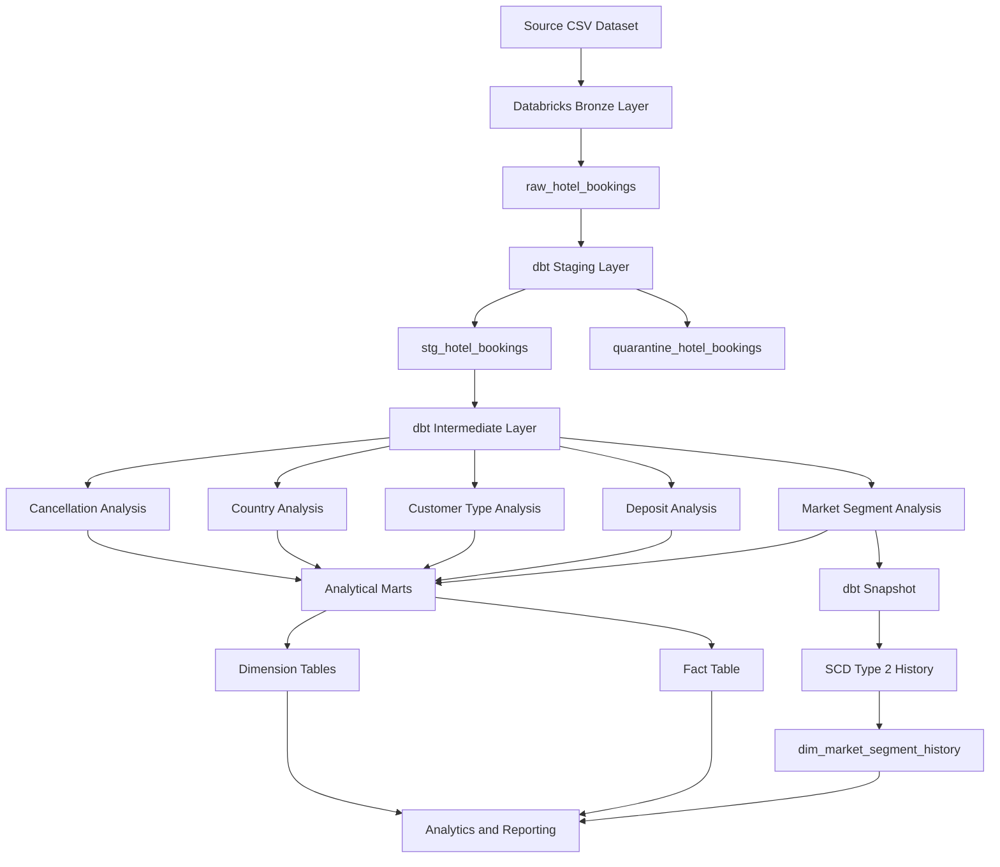
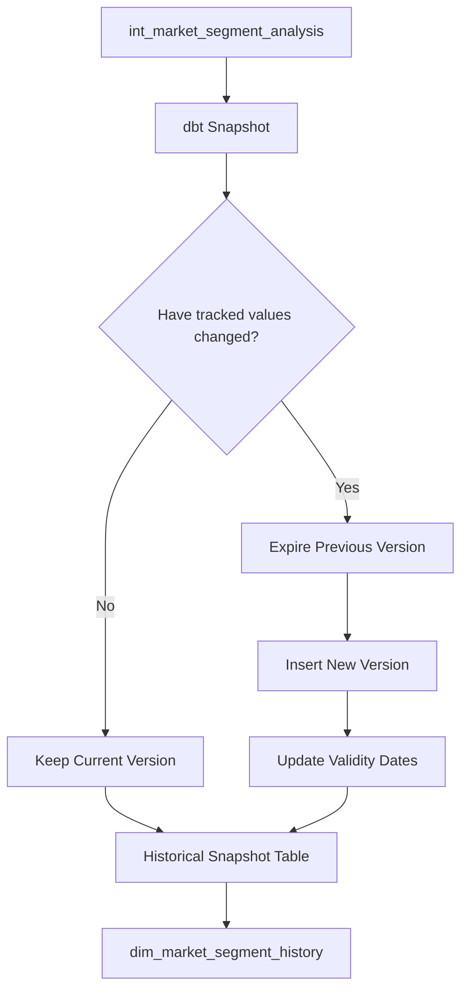
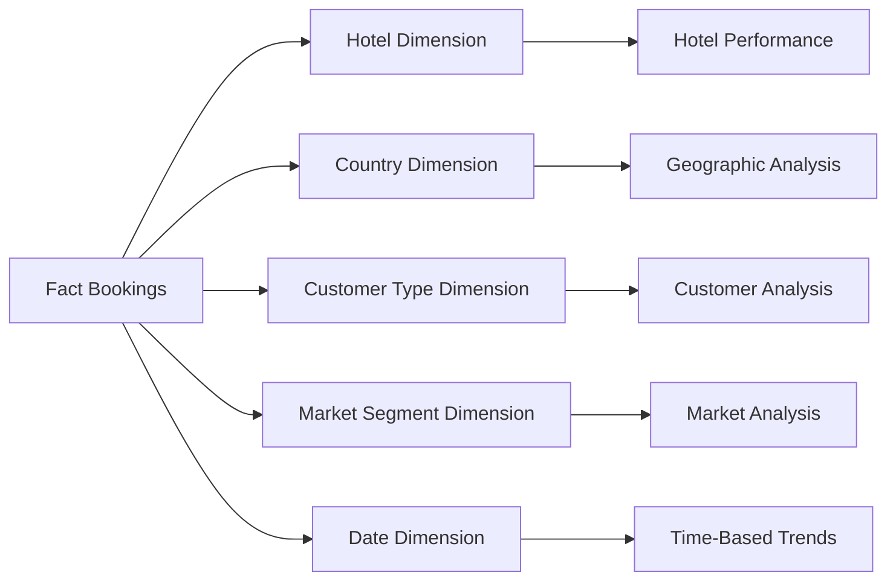
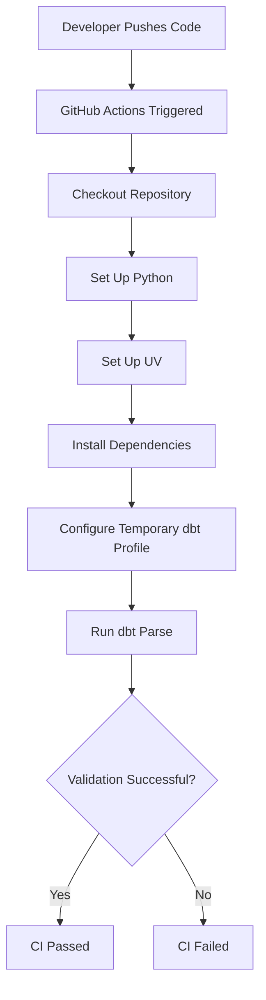

# Hotel Booking Analytics Platform

A Databricks Lakehouse analytics platform built using **Databricks, dbt Core, Delta Lake, SQL, Python and GitHub Actions**. The project transforms hotel booking data into structured analytical datasets to support booking performance, cancellation analysis, customer segmentation, market analysis and revenue insights.

---

## Table of Contents

1. [Project Overview](#project-overview)
2. [Business Objectives](#business-objectives)
3. [Technology Stack](#technology-stack)
4. [Architecture](#architecture)
5. [Dataset Overview](#dataset-overview)
6. [Data Engineering Workflow](#data-engineering-workflow)
7. [dbt Data Models](#dbt-data-models)
8. [SCD Type 2 Historical Tracking](#scd-type-2-historical-tracking)
9. [Data Quality and Validation](#data-quality-and-validation)
10. [Business Analytics](#business-analytics)
11. [GitHub Actions CI](#github-actions-ci)
12. [Project Structure](#project-structure)
13. [Setup and Execution](#setup-and-execution)
14. [Future Enhancements](#future-enhancements)

---

## Project Overview

This project implements an analytical data engineering pipeline using a Databricks Lakehouse architecture and dbt Core.

The pipeline ingests hotel booking data into a Bronze layer and applies modular SQL transformations through dbt to create reusable analytical datasets.

It covers:

- Source data ingestion and Bronze storage.
- Data cleaning and standardization.
- Invalid record identification and quarantine.
- Reusable intermediate business transformations.
- Fact and dimension modelling.
- Historical data tracking using SCD Type 2.
- Data quality testing.
- Git-based development and automated CI validation.

The resulting datasets support analytical queries across hotel performance, booking trends, customer behavior, cancellations and market segments.

## Business Objectives

The project addresses the following analytical requirements:

- Understand booking distribution across City Hotels and Resort Hotels.
- Analyze cancellation patterns and booking status.
- Evaluate market segment and deposit type performance.
- Understand customer type and country-level booking trends.
- Analyze average daily rate (ADR) and lead-time patterns.
- Maintain historical records when market segment metrics change.
- Provide reusable, analytics-ready fact and dimension tables.

## Technology Stack

| Category | Technologies |
|---|---|
| Cloud Data Platform | Databricks |
| Data Storage | Delta Lake |
| Data Architecture | Lakehouse, Bronze/Silver/Gold |
| Transformation | dbt Core, SQL, Jinja |
| Databricks Adapter | dbt-databricks |
| Programming | Python, SQL |
| Dependency Management | UV |
| Data Modelling | Fact and Dimension Modelling |
| Historical Tracking | dbt Snapshots, SCD Type 2 |
| Data Quality | dbt Tests |
| Version Control | Git, GitHub |
| CI Automation | GitHub Actions |

---

## Architecture

### End-to-End Data Architecture

The project uses a layered Lakehouse architecture to separate raw data, transformations and analytical outputs.



### Data Layer Responsibilities

| Layer | Responsibility |
|---|---|
| Bronze | Stores the original source dataset in Databricks. |
| Silver | Contains cleaned, standardized and transformed data, including the analytical models. |
| Gold | Contains the dedicated historical market segment dimension output. |

**Physical schema configuration:** The raw source is stored in `bronze`. The staging, intermediate and most mart models use `silver`. The historical dimension model is configured in `gold`.

### Logical Data Flow

```text
CSV Source
    |
    v
Databricks Bronze
    |
    v
Staging and Data Quality
    |
    +------> Quarantine Records
    |
    v
Intermediate Business Transformations
    |
    v
Fact and Dimension Models
    |
    +------> Analytical Queries
    |
    v
dbt Snapshot
    |
    v
SCD Type 2 Historical Dimension
```

---

## Dataset Overview

The project uses a hotel booking dataset containing reservation details, customer information, hotel types, market segments, deposit information and booking status.

### Dataset Statistics

| Metric | Value |
|---|---:|
| Original source records | 119,390 |
| City Hotel bookings | 79,330 |
| Resort Hotel bookings | 40,060 |
| Records in staging before the SCD2 test insertion | 119,209 |
| Records filtered by staging rules | 181 |

The staging layer applies guest-count and ADR validation rules, so the staging record count is lower than the original source count.

**Note:** A synthetic test booking was subsequently inserted into Bronze to validate SCD Type 2 behavior. It is retained in the development dataset.

### Main Dataset Attributes

The source contains attributes covering:

- Hotel type.
- Booking cancellation status.
- Lead time.
- Arrival date.
- Weekend and weekday stays.
- Adults, children and babies.
- Country and market segment.
- Distribution channel.
- Customer type.
- Deposit type.
- Reserved and assigned room types.
- Average daily rate.
- Previous bookings and cancellations.
- Reservation status and status date.

Source table:

`hotel_booking_catalog.bronze.raw_hotel_bookings`

---

## Data Engineering Workflow

### 1. Bronze Layer

The original CSV data is stored in a Databricks Delta table:

`hotel_booking_catalog.bronze.raw_hotel_bookings`

The Bronze layer preserves the source data for downstream transformations.

### 2. Staging Layer

The staging layer standardizes and validates the source data.

**Model: `stg_hotel_bookings.sql`**

Key transformations:

- Converts children values into numeric values using `try_cast`.
- Handles missing country and market segment values.
- Standardizes booking status.
- Derives hotel type.
- Applies guest-count validation.
- Filters records with negative ADR.
- Exposes cleaned columns for downstream transformations.

The staging output is:

`hotel_booking_catalog.silver.stg_hotel_bookings`

**Model: `quarantine_hotel_bookings.sql`**

Identifies records that fail the guest-count or ADR validation conditions.

The quarantine model provides visibility into invalid source records instead of mixing them with valid staging records.

### 3. Intermediate Layer

The intermediate layer contains reusable business transformations.

| Model | Purpose |
|---|---|
| `int_cancellation_analysis` | Analyzes booking cancellations. |
| `int_country_bookings` | Analyzes booking distribution by country. |
| `int_customer_type_analysis` | Analyzes customer booking behavior. |
| `int_deposit_analysis` | Evaluates deposit type and booking performance. |
| `int_market_segment_analysis` | Aggregates market segment and deposit type metrics. |

These models provide a reusable foundation for downstream analytical modelling.

### 4. Marts Layer

The marts layer organizes analytical data into fact and dimension models.

**Dimension Models**

| Model | Purpose |
|---|---|
| `dim_country` | Country-level analytical dimension. |
| `dim_customer_type` | Customer classification dimension. |
| `dim_date` | Calendar dimension for date-based analysis. |
| `dim_hotel` | Hotel classification dimension. |
| `dim_market_segment` | Market segment dimension. |
| `dim_market_segment_history` | Historical market segment dimension with SCD Type 2 validity dates. |

**Fact Model**

| Model | Purpose |
|---|---|
| `fct_bookings` | Booking-level analytical fact dataset. |

These models support reusable analytical queries and dimensional analysis.

---

## SCD Type 2 Historical Tracking

The project implements historical tracking using **dbt snapshots with the check strategy**.

The objective is to retain previous versions of market segment metrics whenever the underlying aggregated values change.

### Snapshot Model

`snap_market_segment_analysis.sql`

The snapshot:

- Uses a composite business key based on market segment and deposit type.
- Uses the check strategy to detect changes in selected metric columns.
- Tracks when each version becomes valid.
- Tracks when a previous version stops being current.
- Preserves historical versions rather than overwriting them.

### SCD Type 2 Workflow



### Historical Tracking Columns

The historical dimension exposes:

| Column | Meaning |
|---|---|
| `start_date` | Timestamp when the version became valid. |
| `end_date` | Timestamp when the version stopped being valid. |
| `is_current` | Indicates whether the version is currently active. |

The model derives these fields from dbt snapshot metadata:

- `dbt_valid_from`
- `dbt_valid_to`

### SCD Type 2 Example

The implementation was tested by inserting a synthetic booking that changed the aggregated booking count for a market segment and deposit type.

The snapshot then captured two versions:

| Version | Total Bookings | Is Current |
|---|---:|---|
| Previous version | 56,334 | False |
| Updated version | 56,335 | True |

The previous version received an end timestamp, and the new version received a new start timestamp.

This confirmed that historical and current versions were retained instead of simply overwriting the earlier record.

---

## Data Quality and Validation

The project uses dbt tests to validate model integrity and data quality.

### Implemented Test Categories

- Not-null checks.
- Uniqueness checks.
- Accepted-values checks.
- Relationship tests for referential integrity.

### Quarantine Validation

The quarantine model identifies source records that fail the implemented guest-count and ADR conditions.

### Recorded Validation Results

| Validation | Result |
|---|---:|
| dbt models successfully executed in the recorded validation run | 13 |
| dbt tests passed in the recorded validation run | 19 |
| Test failures | 0 |
| Test warnings | 0 |

These are results from the recorded successful project validation, not a claim that every future deployment has passed.

---

## Business Analytics

The analytical models support several business use cases.

| Business Area | Analytical Questions |
|---|---|
| Cancellation Analysis | Which booking segments have higher cancellation activity? |
| Hotel Performance | How do City Hotels and Resort Hotels compare? |
| Country Analysis | Which countries contribute the most bookings? |
| Customer Analysis | How do customer types differ in booking behavior? |
| Market Segments | Which market segments generate more bookings? |
| Deposit Analysis | How does deposit type relate to booking patterns? |
| Revenue Indicators | How does ADR vary across booking categories? |
| Lead-Time Analysis | How far in advance do customers book? |
| Historical Analysis | How have market segment metrics changed over time? |
| Calendar Analysis | How do bookings vary across arrival dates? |

### Example Analytical Flow



---

## GitHub Actions CI

The project includes an automated Continuous Integration workflow using GitHub Actions.

Workflow file:

`.github/workflows/dbt-ci.yml`

### CI Workflow



### Automated Steps

1. Checks out the GitHub repository.
2. Sets up Python using the repository's `.python-version`.
3. Installs UV.
4. Installs project dependencies using `uv sync --frozen`.
5. Creates a temporary dbt profile using GitHub Secrets.
6. Executes `dbt parse` to validate the dbt project.

### Workflow Triggers

- Pushes to branches.
- Pull requests targeting `main`.

### Secret Management

The following connection settings are maintained as GitHub Actions Secrets:

- `DATABRICKS_HOST`
- `DATABRICKS_HTTP_PATH`
- `DATABRICKS_TOKEN`

Credentials are not committed to the repository.

**Current CI scope:** The automated workflow validates the dbt project using `dbt parse`. It does not yet execute Databricks models, run remote data quality tests or deploy production changes.

---

## Project Structure

```text
hotel-booking-analytics/
│
├── .github/
│   └── workflows/
│       └── dbt-ci.yml
│
├── dbt_hotel_booking/
│   │
│   ├── analyses/
│   ├── macros/
│   │   └── generate_schema_name.sql
│   │
│   ├── models/
│   │   │
│   │   ├── source/
│   │   │   └── sources.yml
│   │   │
│   │   ├── staging/
│   │   │   ├── stg_hotel_bookings.sql
│   │   │   ├── quarantine_hotel_bookings.sql
│   │   │   └── schema.yml
│   │   │
│   │   ├── intermediate/
│   │   │   ├── int_cancellation_analysis.sql
│   │   │   ├── int_country_bookings.sql
│   │   │   ├── int_customer_type_analysis.sql
│   │   │   ├── int_deposit_analysis.sql
│   │   │   └── int_market_segment_analysis.sql
│   │   │
│   │   └── marts/
│   │       ├── dimensions/
│   │       │   ├── dim_country.sql
│   │       │   ├── dim_customer_type.sql
│   │       │   ├── dim_date.sql
│   │       │   ├── dim_hotel.sql
│   │       │   ├── dim_market_segment.sql
│   │       │   └── dim_market_segment_history.sql
│   │       │
│   │       ├── facts/
│   │       │   └── fct_bookings.sql
│   │       │
│   │       └── schema.yml
│   │
│   ├── snapshots/
│   │   └── snap_market_segment_analysis.sql
│   │
│   ├── seeds/
│   ├── tests/
│   ├── README.md
│   └── dbt_project.yml
│
├── .python-version
├── .gitignore
├── pyproject.toml
├── uv.lock
└── README.md
```

---

## Setup and Execution

### Prerequisites

- Python 3.12
- UV
- Databricks workspace
- Databricks SQL Warehouse
- Git

### 1. Clone the Repository

```bash
git clone https://github.com/Ankit-Gokhroo/hotel-booking-analytics.git

cd hotel-booking-analytics
```

### 2. Install Dependencies

```bash
uv sync
```

### 3. Configure Databricks Connection

Create or update:

`~/.dbt/profiles.yml`

Example structure:

```yaml
dbt_hotel_booking:
  target: dev
  outputs:
    dev:
      type: databricks
      catalog: hotel_booking_catalog
      schema: silver
      host: YOUR_DATABRICKS_HOST
      http_path: YOUR_SQL_WAREHOUSE_HTTP_PATH
      token: YOUR_DATABRICKS_TOKEN
```

Use your own Databricks connection values. Never commit access tokens or credentials.

### 4. Validate the dbt Connection

```bash
uv run dbt debug --project-dir dbt_hotel_booking
```

### 5. Parse the dbt Project

```bash
uv run dbt parse --project-dir dbt_hotel_booking
```

### 6. Execute Models

```bash
uv run dbt run --project-dir dbt_hotel_booking
```

### 7. Run Data Quality Tests

```bash
uv run dbt test --project-dir dbt_hotel_booking
```

### 8. Execute Snapshots

```bash
uv run dbt snapshot --project-dir dbt_hotel_booking
```

### Important Execution Notes

- Run snapshots after the upstream models have been updated.
- Rebuild the historical dimension model after snapshot execution when required.
- The project uses a custom schema naming macro to control model schema placement.
- Review the configured target and schema before running commands against a shared Databricks environment.

---

## Future Enhancements

Potential next improvements include:

- Continuous Deployment of dbt models to Databricks.
- Separate development and production environments.
- Automated dbt model execution and testing in GitHub Actions.
- Production deployment approvals.
- Advanced data quality monitoring.
- BI dashboards and business performance visualizations.
- Incremental model strategies for larger datasets.

---

## Project Objective

This project demonstrates practical data engineering capabilities across:

- Databricks Lakehouse architecture.
- dbt Core and modular SQL transformations.
- Data cleaning and quarantine handling.
- Fact and dimension modelling.
- SCD Type 2 historical tracking.
- Data quality testing.
- Git-based development and Pull Requests.
- GitHub Actions-based Continuous Integration.

**The goal is to build a maintainable, testable and version-controlled analytical data platform using modern data engineering practices.**